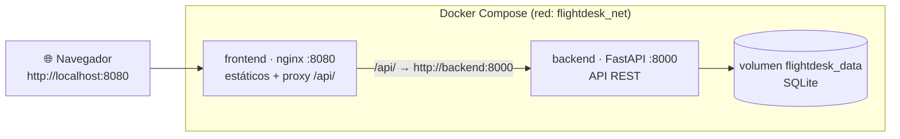

# ✈ FlightDesk API Lab

**Laboratorio práctico para aprender API REST** construyendo un sistema de
gestión de vuelos con **FastAPI + SQLAlchemy + SQLite**, una interfaz web
con **nginx** como proxy inverso, y despliegue con **Docker Compose**.

> Proyecto educativo: no procesa pagos ni contiene datos personales reales.

---

## 🎯 Objetivos de aprendizaje

Al completar este laboratorio comprenderás:

- Qué es una API REST: recursos, endpoints, verbos HTTP, códigos de estado.
- Cómo diseñar endpoints coherentes (CRUD + filtros + estadísticas).
- Validación de datos con Pydantic y manejo de errores con HTTP semánticos.
- Cómo viaja una solicitud: navegador → nginx (proxy) → FastAPI → SQLite.
- Consumo de una API desde JavaScript con `fetch()` y manejo de errores.
- Contenedores, imágenes, volúmenes y redes con Docker Compose.
- Observabilidad básica: logs estructurados, métricas, healthchecks.
- Pruebas automatizadas con pytest y TestClient.
- Cómo publicar un proyecto profesional en GitHub.

## 🧰 Tecnologías

| Capa | Tecnología |
|---|---|
| Backend | Python 3.12, FastAPI, Pydantic v2, SQLAlchemy 2.0, Uvicorn |
| Base de datos | SQLite (persistente en volumen Docker) |
| Frontend | HTML5, CSS3, JavaScript moderno (sin frameworks) |
| Servidor web | nginx 1.27 (estáticos + proxy inverso) |
| Infraestructura | Docker, Docker Compose |
| Pruebas | pytest, httpx (TestClient) |

## 🏗 Arquitectura



## 📋 Requisitos previos

- **Docker** y **Docker Compose** (v2) instalados y en ejecución.
  - Windows/macOS: [Docker Desktop](https://www.docker.com/products/docker-desktop/).
  - Linux: sigue la guía oficial de tu distribución.
- (Opcional, para desarrollo sin Docker) Python 3.11+ y `pip`.
- (Opcional) `curl` para probar la API desde terminal.

## 🚀 Instalación paso a paso

```bash
# 1. Clona el repositorio
git clone https://github.com/TU_USUARIO/flightdesk-api-lab.git
cd flightdesk-api-lab

# 2. Copia la configuración de ejemplo
cp .env.example .env

# 3. (Opcional) ajusta puertos en .env

# 4. Construye y levanta los servicios
docker compose up --build -d

# 5. Espera a que el backend esté saludable
docker compose ps        # busca "healthy" en backend
```

## 🔗 URLs y puertos

| Recurso | URL |
|---|---|
| Interfaz web | http://localhost:8080 |
| API (vía proxy del frontend) | http://localhost:8080/api/v1/ |
| API directa | http://localhost:8000/api/v1/ |
| Documentación interactiva (Swagger) | http://localhost:8000/docs |
| Redoc | http://localhost:8000/redoc |

Puertos configurables en `.env` (`FRONTEND_PORT`, `BACKEND_PORT`).

## ⚙️ Configuración de variables de entorno

Copia `.env.example` a `.env`. Variables disponibles:

| Variable | Default | Descripción |
|---|---|---|
| `FRONTEND_PORT` | `8080` | Puerto de la interfaz web |
| `BACKEND_PORT` | `8000` | Puerto de la API directa |
| `FLIGHTDESK_DATABASE_URL` | `sqlite:////app/data/flights.db` | Ubicación de la BD (dentro del volumen) |
| `FLIGHTDESK_CORS_ORIGINS` | `http://localhost:8080,...` | Orígenes permitidos para CORS |
| `FLIGHTDESK_DEMO_SEED` | `true` | Sembrar 8 vuelos de demostración al primer arranque |
| `FLIGHTDESK_LOG_LEVEL` | `INFO` | Nivel de logs (DEBUG/INFO/WARNING/ERROR) |
| `FLIGHTDESK_SLOW_REQUEST_MS` | `500` | Umbral para marcar solicitudes lentas |

## 📡 Endpoints principales

| Método | Endpoint | Función | Éxito |
|---|---|---|---|
| GET | `/api/v1/flights` | Listar vuelos (con filtros) | 200 |
| GET | `/api/v1/flights/{id}` | Consultar un vuelo | 200 / 404 |
| POST | `/api/v1/flights` | Crear un vuelo | 201 / 409 / 422 |
| PUT | `/api/v1/flights/{id}` | Reemplazar campos editables | 200 / 404 / 409 |
| PATCH | `/api/v1/flights/{id}` | Actualización parcial | 200 / 400 / 404 |
| DELETE | `/api/v1/flights/{id}` | Eliminar un vuelo | 204 / 404 |
| GET | `/api/v1/health` | Salud del backend | 200 / 503 |
| GET | `/api/v1/stats` | Estadísticas | 200 |
| GET | `/api/v1/metrics` | Métricas de la API | 200 |

Referencia completa: [docs/api-reference.md](docs/api-reference.md).

### Ejemplos

```bash
# Listar con filtros
curl "http://localhost:8000/api/v1/flights?origin=PTY&status=SCHEDULED"

# Crear un vuelo (201 Created)
curl -X POST http://localhost:8000/api/v1/flights \
  -H "Content-Type: application/json" \
  -d '{
    "flight_number": "AV101",
    "origin": "PTY",
    "destination": "MIA",
    "departure_time": "2026-10-10T10:00:00",
    "arrival_time": "2026-10-10T14:00:00",
    "status": "SCHEDULED"
  }'

# Actualización parcial (200 OK)
curl -X PATCH http://localhost:8000/api/v1/flights/1 \
  -H "Content-Type: application/json" \
  -d '{"status": "DELAYED"}'

# Eliminar (204 No Content)
curl -X DELETE http://localhost:8000/api/v1/flights/1
```

Respuesta de creación:

```json
{
  "id": 1,
  "flight_number": "AV101",
  "origin": "PTY",
  "destination": "MIA",
  "departure_time": "2026-10-10T10:00:00",
  "arrival_time": "2026-10-10T14:00:00",
  "status": "SCHEDULED",
  "created_at": "2026-10-09T12:00:00",
  "updated_at": "2026-10-09T12:00:00"
}
```

## 🧪 Pruebas automatizadas

```bash
# Con Docker (imagen del backend incluye pytest):
docker compose exec backend python -m pytest -q

# Sin Docker:
cd backend
python3 -m venv .venv && source .venv/bin/activate
pip install -r requirements.txt
python -m pytest -q        # 22 pruebas
```

Las pruebas usan una **base de datos temporal aislada** (`tmp_path`),
nunca la base de datos del laboratorio. Para investigar un fallo:
`pytest -x --tb=long` muestra la traza completa; los logs JSON del test
aparecen en la salida capturada.

## 🩺 Comandos de diagnóstico

```bash
docker compose ps                       # estado y healthchecks
docker compose logs -f backend        # logs en vivo (JSON estructurado)
docker compose logs backend | grep ERROR
docker compose exec backend ls -la /app/data   # verificar volumen
docker stats                          # recursos
./scripts/smoke_test.sh http://localhost:8000  # prueba de extremos
./scripts/reset-lab.sh                # reinicio completo (¡borra datos!)
```

## 🧩 Problemas comunes

| Síntoma | Causa probable | Solución |
|---|---|---|
| El frontend no carga vuelos | Backend caído o proxy mal configurado | `curl :8000/api/v1/health` y `curl :8080/api/v1/health`; revisa `logs frontend` |
| Error 500 | Fallo interno | Busca el `request_id` en `logs backend` |
| 404 | Id inexistente o ruta mal escrita | Compara con `/docs` |
| Bloqueo CORS | Origen no permitido | Añade el origen a `FLIGHTDESK_CORS_ORIGINS` o usa el proxy |
| Backend reiniciándose | Error de arranque | `docker compose logs backend \| head -50` |
| Datos perdidos | Se eliminó el volumen | `down --volumes` y `reset-lab.sh` borran a propósito; usa solo `down` |
| Cambios de código no aparecen | No se reconstruyó | `docker compose up --build -d` |

Guía completa de diagnóstico con 12 escenarios:
[docs/troubleshooting.md](docs/troubleshooting.md).

## 🔐 Consideraciones de seguridad

- **Sin autenticación** (deliberado: la seguridad fingida es peor que
  ninguna). Cualquiera con acceso al puerto puede modificar datos.
- **No expongas este laboratorio a Internet.**
- Datos validados con Pydantic; consultas parametrizadas (SQLAlchemy);
  CORS restringido; contenedores sin root; sin secretos en Git.
- Detalles: [docs/security.md](docs/security.md).

## ⚠️ Limitaciones conocidas

1. Sin autenticación/autorización.
2. SQLite: no apto para escritura concurrente intensa.
3. Las horas se almacenan en UTC y se muestran en hora local del
   navegador; el formulario de creación usa la hora local del equipo
   como UTC (ajústalo si tu zona horaria difiere).
4. Métricas en memoria: se pierden al recrear el contenedor.
5. Sin HTTPS, rate limiting ni copias de seguridad automáticas.

## 🚀 Mejoras futuras sugeridas

- Autenticación OAuth2/JWT con roles (solo operadores pueden DELETE).
- Paginación con links `next`/`prev` (hipermedia).
- PostgreSQL en su propio contenedor.
- Trazas distribuidas con OpenTelemetry → Jaeger (y de ahí a
  Application Insights o Dynatrace).
- CI/CD con GitHub Actions (pytest + build de imágenes).
- WebSockets/SSE para actualizaciones en vivo de estados de vuelos.

## 📚 Documentación

| Documento | Contenido |
|---|---|
| [docs/learning-guide.md](docs/learning-guide.md) | API REST desde cero: 16 conceptos con ejercicios |
| [docs/architecture.md](docs/architecture.md) | Arquitectura, flujo de solicitudes, modelo de datos |
| [docs/api-reference.md](docs/api-reference.md) | Referencia completa de endpoints y códigos HTTP |
| [docs/docker-guide.md](docs/docker-guide.md) | Conceptos y comandos de Docker/Compose |
| [docs/troubleshooting.md](docs/troubleshooting.md) | 12 escenarios de diagnóstico (con soluciones) |
| [docs/security.md](docs/security.md) | Prácticas, limitaciones y evolución futura |

## 📄 Licencia

MIT — ver [LICENSE](LICENSE).

## 🤝 Contribuir

Ver [CONTRIBUTING.md](CONTRIBUTING.md).
