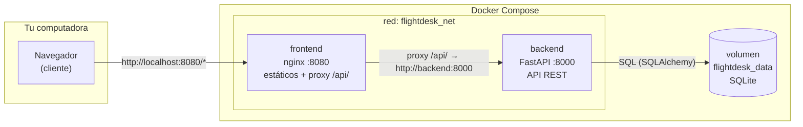
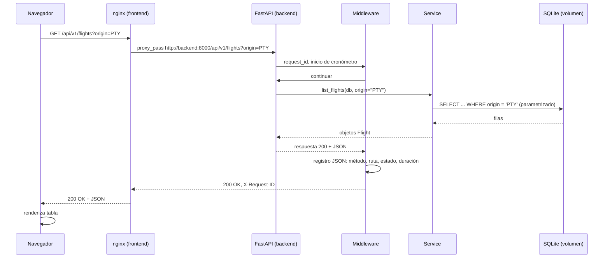

# Arquitectura

## Vista general



## ¿Por qué esta arquitectura?

| Decisión | Justificación |
|---|---|
| Dos servicios separados | Frontend y backend tienen ciclos de vida distintos; separarlos enseña comunicación por HTTP real, no imports de Python. |
| Proxy inverso en nginx | El navegador solo conoce `localhost:8080`; no necesita resolver nombres internos de Docker y no hay problemas de CORS. |
| SQLite en volumen | Sin un tercer contenedor: la base de datos es un archivo dentro de un volumen Docker, lo que persiste entre recreaciones de contenedores. |
| Capas (api / schemas / services / models) | El router traduce HTTP, el servicio contiene reglas, el modelo define persistencia. Cambiar una capa no rompe las otras. |
| Sin Kubernetes/Terraform | El objetivo son los fundamentos; complejidad innecesaria = menos aprendizaje. |

## Recorrido de una solicitud (ejemplo: listar vuelos)



## Estructura de carpetas del backend

```
backend/
├── app/
│   ├── main.py            # punto de entrada, middleware, lifespan
│   ├── config.py          # variables de entorno -> Settings
│   ├── database.py        # motor SQLAlchemy, sesiones
│   ├── logging_config.py  # logs JSON + métricas en memoria
│   ├── api/
│   │   ├── flights.py     # endpoints CRUD + stats (traduce HTTP<->servicio)
│   │   └── monitoring.py  # /health, /metrics
│   ├── models/
│   │   └── flight.py      # tabla flights (SQLAlchemy)
│   ├── schemas/
│   │   └── flight.py      # contratos JSON (Pydantic) y validación
│   └── services/
│       └── flight_service.py  # reglas de negocio + acceso a datos
├── tests/                 # pytest con base de datos aislada
├── requirements.txt       # dependencias fijadas
└── Dockerfile
```

## Modelo de datos

Tabla `flights`:

| Columna | Tipo | Restricciones |
|---|---|---|
| id | INTEGER | PK autoincremental |
| flight_number | VARCHAR(10) | UNIQUE, NOT NULL |
| origin | VARCHAR(3) | NOT NULL, index |
| destination | VARCHAR(3) | NOT NULL, index |
| departure_time | DATETIME | NOT NULL |
| arrival_time | DATETIME | NOT NULL |
| status | VARCHAR(20) | NOT NULL, index |
| created_at | DATETIME | DEFAULT ahora(UTC) |
| updated_at | DATETIME | DEFAULT ahora, ON UPDATE ahora |

Índices: `flight_number` (unicidad), `origin`, `destination`, `status`
(filtros) e índice compuesto `(origin, destination)`.

**Convención de zonas horarias:** todas las fechas se almacenan en UTC
sin información de zona (`naive`). El frontend las muestra convirtiendo
a hora local del navegador.

## Reglas de negocio

1. `arrival_time > departure_time` (siempre).
2. `origin != destination`.
3. `flight_number` único (2–8 caracteres alfanuméricos).
4. `status` pertenece a un conjunto cerrado: SCHEDULED, BOARDING,
   DEPARTED, ARRIVED, DELAYED, CANCELLED.
5. `flight_number`, `origin` y `destination` se normalizan a mayúsculas.

## Frontend

```
frontend/
├── index.html    # estructura: header, stats, tabla, formularios
├── styles.css    # tema oscuro, CSS Grid, responsive (3 breakpoints)
├── app.js        # cliente fetch() con manejo de errores
├── nginx.conf    # servidor estático + proxy inverso /api/
└── Dockerfile
```

Flujo de datos en `app.js`:

```mermaid
graph TD
    A[Evento de usuario] --> B[api(method, path, body)]
    B --> C{fetch() ok?}
    C -- error de red --> D[toast: sin conexión]
    C -- respuesta HTTP --> E{response.ok?}
    E -- no --> F[extraer mensaje de error<br/>404/409/422/...]
    F --> G[toast de error]
    E -- sí --> H[parsear JSON]
    H --> I[actualizar state]
    I --> J[renderizar tabla/estadísticas]
```

**Ninguna operación se simula:** la interfaz solo cambia después de que
la API confirma la operación (201/200/204).
