# Guía de Docker y Docker Compose

## Conceptos fundamentales

**Imagen:** una plantilla de solo lectura (sistema de archivos +
configuración de arranque). Se construye desde un `Dockerfile`.
Ejemplo: `flightdesk-backend` construida desde `python:3.12.8-slim-bookworm`.

**Contenedor:** una *instancia en ejecución* de una imagen, con su propia
capa escribible aislada. Una imagen puede tener muchos contenedores.

**Imagen vs contenedor:** imagen = clase, contenedor = objeto instanciado.
Borras el contenedor, la imagen sigue ahí.

**Volumen:** almacenamiento persistente gestionado por Docker, *externo*
al contenedor. Aquí montamos `flightdesk_data` en `/app/data` para que el
archivo SQLite sobreviva a `docker compose down` y a la recreación de
contenedores.

**Red Docker:** una red interna donde los servicios se descubren por
nombre de servicio. `frontend` alcanza al backend como `http://backend:8000`
sin exponer nada a tu máquina.

**Docker Compose:** herramienta que define y orquesta multi-contendedores
desde `compose.yaml`: construye, crea, conecta y publica servicios con un
solo comando.

**Publicar vs exponer un puerto:**
- `EXPOSE 8000` en el Dockerfile es *documentación* (no abre nada).
- `ports: - "8000:8000"` en compose **publica** el puerto en tu máquina:
  `localhost:8000` → contenedor.
- El frontend **no** necesita publicar el backend para funcionar: ambos se
  comunican por la red interna. Publicamos 8000 solo para probar la API
  directamente con curl.

**Healthcheck:** comando que Docker ejecuta periódicamente dentro del
contenedor. Si falla repetidamente, el contenedor se marca `unhealthy`
y Compose puede negarse a arrancar servicios dependientes
(`depends_on: condition: service_healthy`).

**Logs:** `docker compose logs -f backend` muestra la salida stdout/stderr
del contenedor en tiempo real (nuestros logs JSON van a stdout).

**Reconstruir una imagen:** los cambios de código requieren reconstruir:
`docker compose up --build -d` (reconstruye solo lo que cambió gracias a
la caché de capas).

## Comandos esenciales

```bash
# Copiar configuración
cp .env.example .env

# Construir y levantar (detached)
docker compose up --build -d

# Ver estado (busca "healthy" en backend)
docker compose ps

# Ver logs en vivo
docker compose logs -f backend
docker compose logs -f frontend

# Probar la API
curl http://localhost:8000/api/v1/health
curl http://localhost:8000/api/v1/flights

# Interfaz web: http://localhost:8080

# Detener (los datos del volumen persisten)
docker compose down

# Detener Y ELIMINAR datos (¡cuidado!)
docker compose down --volumes

# Reconstruir después de cambiar código
docker compose up --build -d

# Ver métricas internas del contenedor
docker stats

# Entrar al contenedor para diagnosticar
docker compose exec backend sh
docker compose exec backend ls -la /app/data

# Inspeccionar la red interna
docker network inspect flightdesk-api-lab_flightdesk_net
```

## Flujo de una solicitud de API (con el proxy)

```mermaid
sequenceDiagram
    participant U as Navegador
    participant F as contenedor frontend (nginx :8080)
    participant B as contenedor backend (FastAPI :8000)
    participant D as volumen flightdesk_data

    U->>F: GET http://localhost:8080/api/v1/flights
    Note over U,F: mismo origen: sin CORS
    F->>B: GET http://backend:8000/api/v1/flights
    Note over F,B: red interna flightdesk_net
    B->>D: SELECT ... FROM flights
    D-->>B: filas
    B-->>F: 200 OK + JSON (X-Request-ID)
    F-->>U: 200 OK + JSON
```



Ventajas de esta estrategia:
- El navegador **no necesita resolver** el nombre interno `backend`.
- Un solo origen → sin configuración de CORS en producción.
- El proxy añade headers de reenvío (`X-Forwarded-*`) y timeouts.

## Puertos documentados

| Puerto | Servicio | Acceso |
|---|---|---|
| 8080 (configurable `FRONTEND_PORT`) | frontend/nginx | Interfaz web |
| 8000 (configurable `BACKEND_PORT`) | backend/FastAPI | API directa + /docs |

## Healthchecks

- **backend:** `python -c "urllib.request.urlopen('http://localhost:8000/api/v1/health')"`
  (no hay curl en la imagen slim; se usa la propia stdlib de Python).
  `start-period: 10s` evita falsos negativos durante el arranque.
- **frontend:** `wget -q -O /dev/null http://localhost:8080/` (busybox de Alpine).

Compose espera a que el backend esté `healthy` antes de crear el frontend
(`depends_on.condition`), evitando errores 502 de arranque.

## Sin root en los contenedores

- backend: usuario `appuser` (UID 1000) creado en el Dockerfile.
- frontend: usuario `nginx` (UID 101); nginx escucha en 8080 y escribe
  PID/temporales en `/tmp` para no necesitar root.

## Reproducibilidad

- Imágenes base con **pin de versión**: `python:3.12.8-slim-bookworm`,
  `nginx:1.27.3-alpine`.
- Dependencias Python con **pin exacto** en `requirements.txt`.
- Sin secretos en imágenes: la configuración viaja por variables de entorno
  (ver `.env.example`), nunca por `COPY` o `ENV` con valores sensibles.
